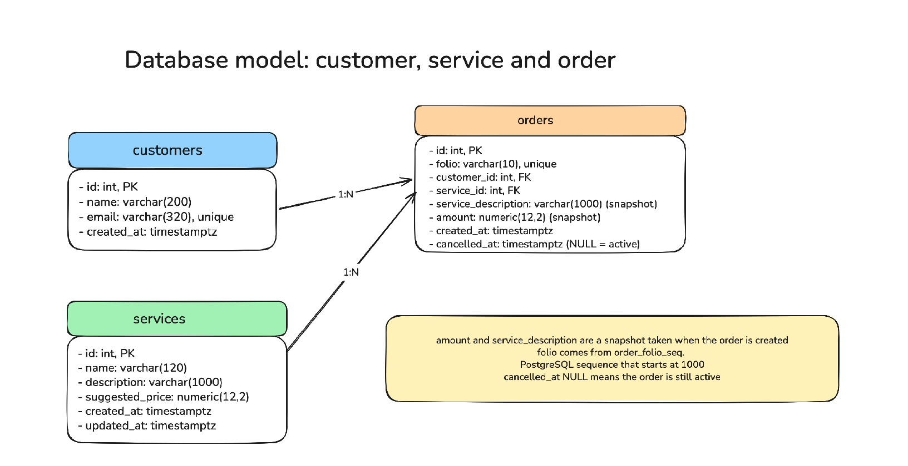
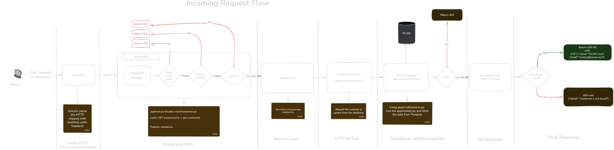
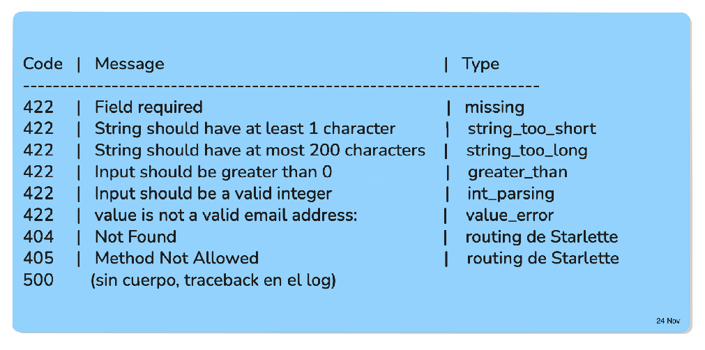

# Customer, Service and Order API

**Python 3.12 · FastAPI · SQLAlchemy 2 · PostgreSQL · Alembic · pytest**

## Install

```bash
uv sync
createdb softtek_assessment
createdb softtek_assessment_test   # the suite drops and recreates this one
uv run alembic upgrade head
```

Without `uv`, using the pinned `requirements.txt`:

```bash
python3.12 -m venv .venv && source .venv/bin/activate
pip install --require-hashes -r requirements.txt
createdb softtek_assessment && createdb softtek_assessment_test
alembic upgrade head
```

The connection strings default to `postgresql+psycopg://localhost:5432/softtek_assessment` (and `..._test`) with the OS user, so a fresh clone needs no `.env`. Override them with `DATABASE_URL` and `TEST_DATABASE_URL`.

## Run

```bash
uv run uvicorn app.main:app --reload
```

Interactive docs at <http://localhost:8000/docs>.

## Sample data

```bash
uv run python -m app.seed
```

To start from an empty database:

```bash
psql -d softtek_assessment \
  -c "TRUNCATE customers, services, orders RESTART IDENTITY CASCADE" \
  -c "ALTER SEQUENCE order_folio_seq RESTART WITH 1000"
```

## Tests

```bash
uv run pytest
```

```bash
uv run ruff check . && uv run ruff format --check . && uv run pyright
```

```bash
uv run pytest --cov=app --cov-report=term-missing
```

## Project structure

```
app/
--main.py       app, error handler, routers
--config.py     settings
--database.py   engine and session
--deps.py       SessionDep
--models.py     Customer, Service, Order
--schemas.py    request and response contracts
--errors.py     DomainError, NotFoundError, ConflictError
--crud/         queries and business rules
--routers/      HTTP layer
--seed.py       sample data
migrations/     three linear revisions
tests/          one file per resource
docs/           design decisions, entity diagram
```

## Data model



Both relationships are one-to-many: a customer places many orders, a service is sold in many orders, and every order references exactly one of each. `amount` and `service_description` are copied at creation, so editing a service never rewrites an order that was already placed.

## Request flow



`GET /customers/1` end to end: routing and validation, the session handed over by `app/deps.py`, the handler in `app/routers/`, the query in `app/crud/`, and the response shaped by `app/schemas.py`. The red branches are the framework's — `404` for an unmatched path, `405` for a wrong method, `422` for a path param that does not convert — and the two `404`s on the right are different: one comes from the router, the other from `get_or_404`.

## Endpoints

| Method  | Path                         | Purpose                                       |
| ------- | ---------------------------- | --------------------------------------------- |
| `POST`  | `/customers`                 | create a customer                             |
| `GET`   | `/customers/{customer_id}`   | read one customer                             |
| `POST`  | `/services`                  | create a service                              |
| `GET`   | `/services/{service_id}`     | read one service                              |
| `PATCH` | `/services/{service_id}`     | update name, description or price             |
| `POST`  | `/orders`                    | create an order, copying the service snapshot |
| `GET`   | `/orders/{order_id}`         | read one order                                |
| `POST`  | `/orders/{order_id}/cancel`  | cancel an order                               |
| `GET`   | `/reports/last-sales`        | the 10 most recent sales, newest first        |
| `GET`   | `/reports/sales-by-customer` | orders and total per customer, biggest first  |
| `GET`   | `/health`                    | liveness                                      |

Both reports exclude cancelled orders and return a flat JSON array. Deliberately out of scope: list endpoints, updating an order, and any form of delete.

## Errors

| Status | When                                                                                              | Body                                                        |
| ------ | ------------------------------------------------------------------------------------------------- | ----------------------------------------------------------- |
| `404`  | unknown id, or the referenced customer or service does not exist                                  | `{"detail": "Customer 99 not found"}`                       |
| `409`  | duplicate email (compared case insensitively), or cancelling an order twice                       | `{"detail": "Order 20 is already cancelled"}`               |
| `422`  | the payload fails validation: missing field, malformed email, price out of range, explicit `null` | `{"detail": [{"type": "...", "loc": [...], "msg": "..."}]}` |



## Customers

```bash
curl -s localhost:8000/customers/1
```

```json
{ "id": 1, "name": "ACME Corp", "email": "contact@acme.com" }
```

## Services

```bash
curl -s localhost:8000/services/1
```

```json
{
  "id": 1,
  "name": "24/7 support",
  "description": "Phone and email support, 8 hour response time",
  "suggested_price": "1500.00",
  "created_at": "2026-11-23T04:30:55.947512-06:00",
  "updated_at": "2026-11-23T04:30:55.947512-06:00"
}
```

## Orders

```bash
curl -s localhost:8000/orders/1
```

```json
{
  "id": 1,
  "folio": "001000",
  "customer_id": 1,
  "service_id": 6,
  "service_description": "Integration with a third party system, quoted per project",
  "amount": "12000.00",
  "created_at": "2026-11-23T04:30:55.957272-06:00",
  "cancelled_at": null,
  "customer": { "id": 1, "name": "ACME Corp" }
}
```

---

Every diagram above is editable: [`docs/diagrams.excalidraw`](docs/diagrams.excalidraw) opens at
<https://excalidraw.com> and holds the data model, the request flow and the error table.